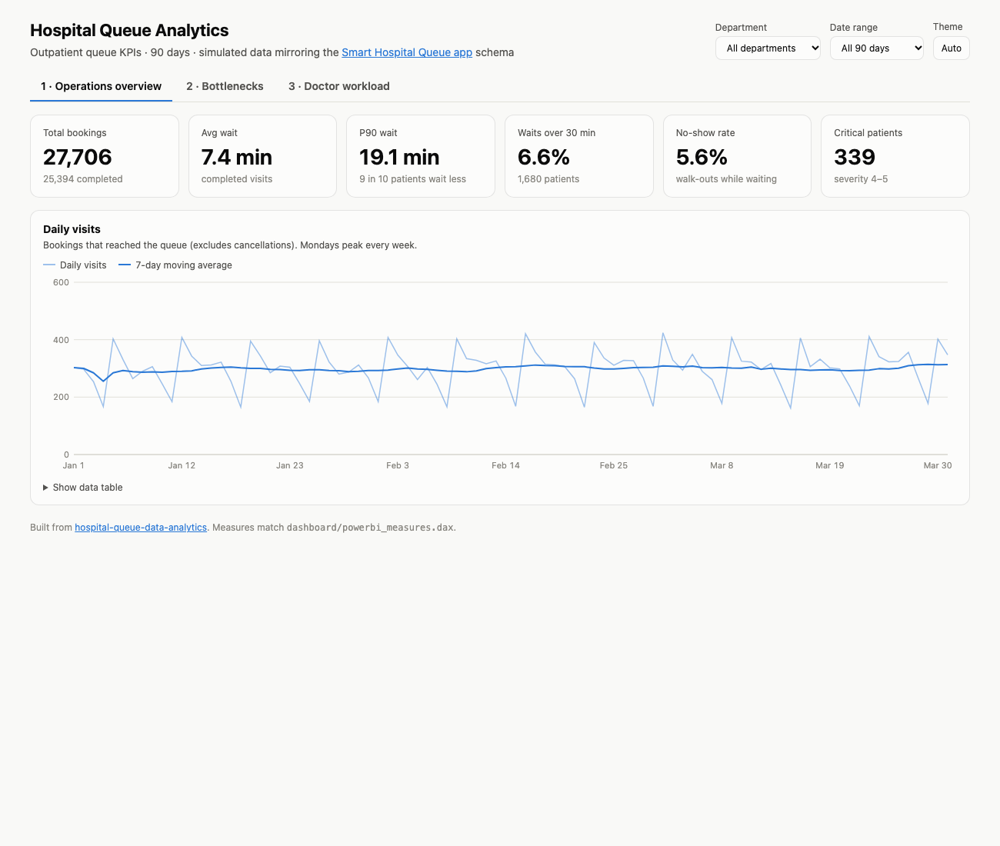
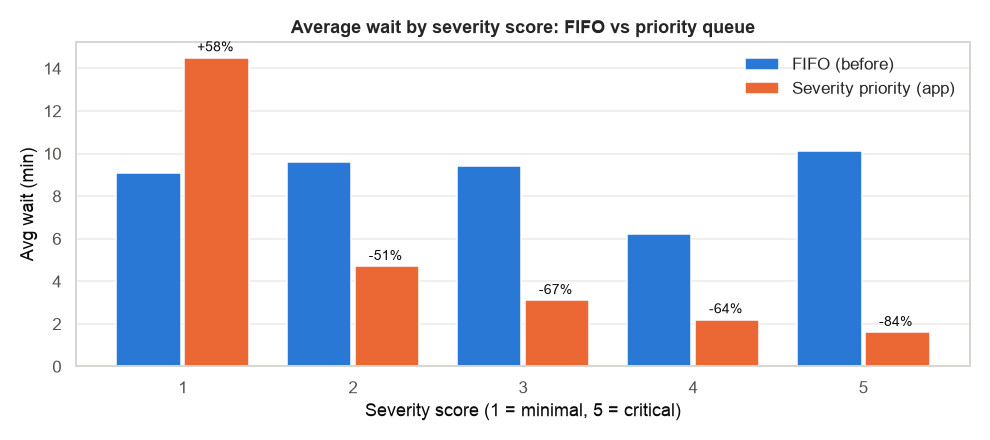

# Hospital Queue Analytics — Smart Hospital OPD Data Analysis

End-to-end data analytics project built on top of my
[AI Smart Hospital Queue Management System](https://github.com/Shashankpabba6/ai-smart-hospital-queue-management-system).
The app manages patient booking, severity triage and doctor queues; this project
analyses the data it produces to find **operational bottlenecks**, measure the
impact of the **severity-priority queue**, and recommend staffing changes.

**Stack:** Python (Pandas, NumPy, SciPy) · SQL (SQLite / MySQL 8, CTEs & window functions) ·
Star-schema data modeling · Matplotlib & Seaborn · Jupyter · Excel (openpyxl) · Power BI (DAX)

### 📊 [Live interactive dashboard →](https://shashankpabba6.github.io/hospital-queue-data-analytics/)
A 3-page KPI dashboard (operations overview, bottlenecks, doctor workload) with department and
date-range slicers. It computes the same measures as the Power BI model in [`dashboard/`](dashboard/).



## Key findings (90 days · 27,706 bookings · 7 departments · 12 doctors)

| KPI | Value |
|-----|-------|
| Average wait (completed visits) | **7.4 min** (P90 ≈ 19 min) |
| Waits over 30 min | **6.6 %** |
| No-show / walk-out rate | **5.7 %** |
| Average consultation | **13.6 min** |

**Four operational bottlenecks**

1. **General Medicine capacity.** It takes 42% of demand with 3 doctors, which is
   **41.9 patients per doctor per day** (16–24 in other departments). Its average wait is 16.9 min,
   18% of its patients wait over 30 min, and its no-show rate is 11.3%.
2. **Morning rush.** **48% of arrivals land between 09:00 and 12:59**, when average waits rise to 14–21 min.
3. **Monday surge.** Monday volume is **+36% above an average day**, and Monday 10–11 AM is the worst slot (23.6 min).
4. **Workload imbalance.** All 3 GM doctors work **100–123% of their 8-hour shift** (Staff Fatigue Index), and one
   doctor's consultations run 3.5 min longer than the department average (ANOVA p < 0.001).

**Longer waits drive walk-outs.** The no-show rate is 2% for waits under 15 min and about 30% for waits over 30 min (χ² test p < 0.001).

### Impact of the app's severity-priority queue
The same simulated arrivals were replayed under **FIFO** and under the app's rule
(`ORDER BY severity_score DESC, queue_position ASC`):

| Severity | FIFO wait | Priority wait | Change |
|----------|-----------|---------------|--------|
| 2 – Mild | 9.6 min | 4.7 min | **−51 %** |
| 3 – Moderate | 9.4 min | 3.1 min | **−67 %** |
| 4 – Severe | 6.2 min | 2.2 min | **−64 %** |
| All patients | 9.3 min | 9.1 min | −2.5 % |

For patients with severity ≥ 3, the wait fell from **9.2 to 3.0 min** (paired t-test p < 0.001), and the share
of patients waiting over 30 min fell from 10.8% to 8.9%. The overall average barely
moves, because reordering a queue does not add capacity. Low-severity patients wait longer instead.



### Recommendation (what-if simulation)
Add **one part-time General Medicine doctor from 09:00 to 13:00**. In simulation:

| Scope | Current | With extra GM doctor |
|-------|---------|----------------------|
| GM average wait | 16.9 min | **8.4 min (−50 %)** |
| GM no-show rate | 11.3 % | **4.8 %** |
| Hospital-wide average wait | 9.1 min | **5.5 min (−40 %)** |

## Pipeline

```
generate_data.py   →  data/raw/*.csv                 synthetic data mirroring the app's DB schema
etl.py             →  appointments_clean.csv         clean + validate + severity triage + quality log
simulate_queue.py  →  appointments.csv               discrete-event queue simulation (FIFO vs priority vs scenario)
load_db.py         →  hospital_queue.db              star schema + row-count reconciliation + Power BI extracts
run_sql_analysis.py→  reports/sql_results/*.csv      10 analytical SQL queries
build_notebook.py  →  notebooks/hospital_queue_eda.ipynb   EDA, statistical tests, charts
build_excel_report.py → dashboard/Hospital_Queue_KPI_Report.xlsx
build_web_dashboard.py → docs/index.html              interactive dashboard (GitHub Pages)
```

```bash
pip install -r requirements.txt
python run_pipeline.py
```

### Data cleaning (ETL)
The raw data has realistic quality problems. Each fix is logged in
[`reports/data_quality_log.csv`](reports/data_quality_log.csv):

| Issue | Rows fixed |
|-------|-----------|
| Duplicate (double-submitted) bookings removed | 166 |
| Inconsistent department labels standardised | 1,173 |
| Fever recorded in °F converted to °C | 549 |
| Impossible SpO₂ / age values nulled | 138 |
| Missing vitals imputed (department median, flagged) | 829 |

The ETL then runs six validation checks (uniqueness, value ranges, domain checks) and fails if any check fails.

### Data model (star schema)
```
             dim_date ─┐
       dim_department ─┼──<  fact_appointment
           dim_doctor ─┘
```
MySQL DDL: [`sql/schema_mysql.sql`](sql/schema_mysql.sql).
Queries: [`sql/analysis_queries.sql`](sql/analysis_queries.sql). They use CTEs, `RANK`,
`DENSE_RANK`, `LAG`, moving averages (`AVG() OVER (ROWS BETWEEN 6 PRECEDING…)`),
`PARTITION BY` comparisons against peers, and `CASE` banding.

### Severity triage
[`src/severity.py`](src/severity.py) is a rule-for-rule Python port of the app's
`predictSeverity()` (fever, blood pressure, SpO₂, age, symptom keywords → score 1–5) and
its Staff Fatigue Index. The analytics therefore score patients exactly as the production queue does.

## Deliverables
| File | What |
|------|------|
| [`notebooks/hospital_queue_eda.ipynb`](notebooks/hospital_queue_eda.ipynb) | Full EDA with 7 charts and ANOVA, χ² and paired t-tests |
| [`dashboard/Hospital_Queue_KPI_Report.xlsx`](dashboard/Hospital_Queue_KPI_Report.xlsx) | Excel report: KPI summary, pivot summaries, heatmap, native charts |
| [`dashboard/powerbi_measures.dax`](dashboard/powerbi_measures.dax) | 13 DAX measures (P90 wait, no-show rate, fatigue index, 7-day MA, WoW %) |
| [`docs/index.html`](docs/index.html) | Interactive web dashboard ([live](https://shashankpabba6.github.io/hospital-queue-data-analytics/)): 6 KPI cards, slicers, tooltips, data tables, light/dark |
| [`dashboard/POWERBI_DASHBOARD.md`](dashboard/POWERBI_DASHBOARD.md) | 3-page Power BI layout with 6 KPI visuals; model CSVs in `dashboard/powerbi_data/` |
| [`reports/figures/`](reports/figures) | Exported charts |

## About the data
Real patient records cannot be published. The data in this project is therefore **synthetic**,
generated by `src/generate_data.py` to match the app's Supabase schema
(`appointments`, `staff`, `users`). Demand patterns (weekday and hourly profile, department
mix, lean GM staffing, one slow consultant) and data-quality problems were modelled
on typical outpatient-department behaviour. The bottlenecks above are what the analysis
recovers from that data. They demonstrate the method; they are not measurements from a real hospital.
The pipeline can be pointed at a real export of the app's `appointments` table by replacing
`data/raw/appointments_raw.csv`.
